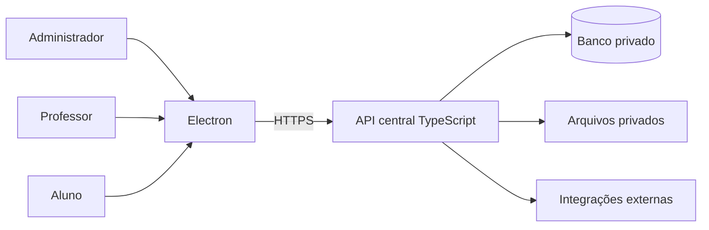

# Arquitetura de implementação

## Contexto

Escola presencial com clientes Electron de administração, professor e aluno. Dados compartilhados são obtidos pela API central; o cliente não recebe credenciais ou cópia do banco.

## Componentes

Transporte HTTP valida formato/limites e delega à aplicação. Serviços em classes definem regras e escopo; portas delimitam consultas e efeitos; repositórios implementam SQL. O bootstrap compõe os adaptadores. `academic/application` não importa frameworks, banco ou Electron.

O backend anterior em `src/main` é um adaptador de compatibilidade durante a extração. Ele não é distribuído como autoridade de dados no modo central; cada novo fluxo de acesso público deve passar pela autenticação/autorização central. Essa transição não equivale a uma refatoração integral já concluída.

Ver ADR 001 para escolha do banco, limites de instância única e migração. Desenvolvimento usa bind loopback; publicação exige proxy HTTPS e autenticação individual concluída. Testes de rede usam servidor real em porta efêmera e banco temporário, sem serviços da escola.
